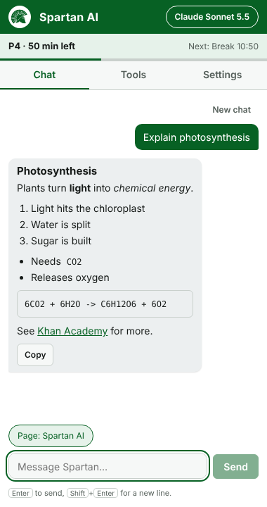

# Spartain AI Extension

A **Google Chrome extension** (Manifest V3) that opens as a **side panel**. Green and white, Spartan helmet logo.

**Current state: UI framework only.** The layout, theme, tabs, and composer work. The AI provider, storage, and page-context pieces are stubs with documented contracts, left open for contributors. See [docs/ROADMAP.md](docs/ROADMAP.md).

**AI backend: a local model** on the user's machine (not the Anthropic API, not a hosted API). The provider boundary is `src/ai/provider.js`.

> New here (human or AI)? Read [CONTRIBUTING.md](CONTRIBUTING.md) first. AI coding agents also read [AGENTS.md](AGENTS.md).

<p align="center"> </p>

## Load it in Chrome

1. Open `chrome://extensions`.
2. Turn on **Developer mode** (top right).
3. Click **Load unpacked** and pick this folder (the one with `manifest.json`).
4. Click the Spartain icon in the toolbar (or press `Ctrl+Shift+S`, `Cmd+Shift+S` on Mac). The side panel opens.

After editing files, click the reload icon on the extension card in `chrome://extensions`. Side panel HTML/CSS changes show after closing and reopening the panel.

## Layout

```
manifest.json                 Extension manifest (MV3). Permissions live here.
assets/
  logo.png                    Original Spartan helmet logo
  logo-transparent.png        Logo with white keyed out (used in the panel)
  icons/icon-{16,32,48,128}.png
src/
  ai/provider.js                STUB: local model call (contract documented inside)
  background/service-worker.js  Opens the panel on toolbar click
  content/content.js            STUB: page title / URL / selection reader
  sidepanel/index.html          The side panel UI (Chat, Tools, Settings tabs)
  sidepanel/sidepanel.css       Layout styles
  sidepanel/sidepanel.js        Tabs, chat rendering, composer, settings form
  sidepanel/storage.js          STUB: chrome.storage persistence
  sidepanel/page-context.js     STUB: current-tab context
  shared/theme.css              Color and spacing tokens (brand green lives here)
  shared/messages.js            Message types + storage keys shared by all scripts
  data/bell-schedule.json       DLS bell schedule by day type (observed, inferred rows flagged)
  data/profile.example.json     Example student profile shape with made-up grades
docs/ROADMAP.md               Open work, one row per stub
.claude/                      Claude Code config and agents (Sonnet)
.github/workflows/            CI + Claude GitHub Action
```

## Scripts

Requires Node 18+. No dependencies are needed to run the extension; `npm install` only pulls ESLint for `npm run lint`.

| Command | What it does |
|---|---|
| `npm run check` | Validates `manifest.json` and syntax-checks every JS file |
| `npm run lint` | ESLint over `src/` |
| `npm run zip` | Builds `dist/spartain-ai.zip` for the Chrome Web Store |

## Colors

| Token | Hex | Use |
|---|---|---|
| `--sp-green` | `#076124` | Primary. Sampled from the logo. |
| `--sp-green-dark` | `#054a1b` | Hover / pressed |
| `--sp-green-light` | `#e6f2ea` | Tints, chips |
| `--sp-white` | `#ffffff` | Background, text on green |

Reference site: https://www.dlshs.org/. Edit colors only in `src/shared/theme.css`.

## Status

- [x] Side panel opens from toolbar and keyboard shortcut
- [x] Chat / Tools / Settings layout, light and dark theme
- [x] Local model settings fields (endpoint, model name) in the Settings tab
- [ ] Local model provider (`src/ai/provider.js`)
- [ ] Persistence (`src/sidepanel/storage.js`)
- [ ] Page context (`src/sidepanel/page-context.js`, `src/content/content.js`)
- [ ] Web Store listing assets

## Using Claude on GitHub

Comment `@claude` on any issue or pull request, for example `@claude implement the storage module per its contract`. The workflow in `.github/workflows/claude.yml` runs Claude Sonnet with the repo rules from `AGENTS.md`. A maintainer must first add the `ANTHROPIC_API_KEY` repository secret and install the Claude GitHub App on the repo.
