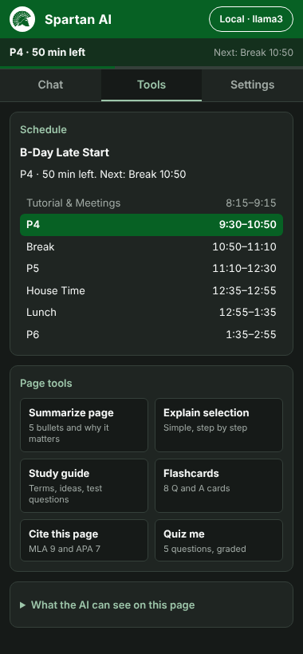

# Spartan AI Extension

A **Google Chrome extension** (Manifest V3) that opens as a **side panel**. Green and white, Spartan helmet logo.

**Current state: working chat and tools (v0.6.1).** Three AI backends, chosen in Settings: a **local model** through [Ollama](https://ollama.com) on your own computer (default, nothing leaves your machine), the **Anthropic API with your own key** (stored only in your browser, never in this repo), or a **team proxy** that holds one shared key server-side and takes a passcode (see [proxy/README.md](proxy/README.md)). Page context, settings, and chat history persist. Open work is in [docs/ROADMAP.md](docs/ROADMAP.md).

> Using Spartan AI means accepting the [Terms of Use](src/legal/terms.md) and reading the [AI Disclaimer](src/legal/ai-disclaimer.md). It is a student project, not an official De La Salle High School product.

> New here (human or AI)? Read [CONTRIBUTING.md](CONTRIBUTING.md) first. AI coding agents also read [AGENTS.md](AGENTS.md).

<p align="center"> </p>

## Get it onto a Mac (or update it)

Paste this into Terminal. It clones the repo into your home folder the first time and pulls the latest version every time after:

```bash
cd ~ && { [ -d Spartain-AI-Extension/.git ] && git -C Spartain-AI-Extension pull --ff-only || git clone https://github.com/gulleedg22-blip/Spartain-AI-Extension.git; }
```

The repository is public, so no sign-in is needed. After a pull, click the reload icon on the Spartan AI card in `chrome://extensions`. Settings and chat history are tied to the folder Chrome loaded, so keep using the same folder.

## Load it in Chrome

1. Open `chrome://extensions`.
2. Turn on **Developer mode** (top right).
3. Click **Load unpacked** and pick this folder (the one with `manifest.json`).
4. Click the Spartan icon in the toolbar (or press `Ctrl+Shift+S`, `Cmd+Shift+S` on Mac). The side panel opens.

After editing files, click the reload icon on the extension card in `chrome://extensions`. Side panel HTML/CSS changes show after closing and reopening the panel.

## Layout

```
manifest.json                 Extension manifest (MV3). Permissions live here.
assets/
  logo.png                    Original Spartan helmet logo
  logo-transparent.png        Logo with white keyed out (used in the panel)
  icons/icon-{16,32,48,128}.png
src/
  ai/provider.js                Model call: Ollama /api/chat or Anthropic Messages API
  background/service-worker.js  Opens the panel on toolbar click
  content/content.js            Page title / URL / selection reader (read-only)
  sidepanel/index.html          The side panel UI (Chat, Tools, Settings tabs)
  sidepanel/sidepanel.css       Layout styles
  sidepanel/sidepanel.js        Tabs, now bar, chat, composer, tools, settings form
  sidepanel/markdown.js         Safe Markdown renderer for AI replies (DOM nodes only, never innerHTML)
  sidepanel/storage.js          chrome.storage persistence
  sidepanel/page-context.js     Current-tab context
  shared/theme.css              Color and spacing tokens (brand green lives here)
  shared/messages.js            Message types + storage keys shared by all scripts
  data/bell-schedule.json       Official DLS bell schedule, six day types
  data/school-calendar-2026-27.json  Semester dates, breaks, finals, day type for every class day through May 12
  tools/schedule.js             Day type, current block, next block (pure functions)
  update/check.js               Compares installed version with main on GitHub
  legal/terms.md                Terms of Use (shown in the extension and here)
  legal/ai-disclaimer.md        AI Disclaimer
  legal/legal.html, .js, .css   In-extension page that renders the two documents
  data/profile.example.json     Example student profile shape with made-up grades
proxy/                        Optional Cloudflare Worker that holds a shared key behind a passcode
docs/source/                  The school's bell schedule and calendar PDFs the data files came from
docs/ROADMAP.md               Open work
.claude/                      Claude Code config and agents (Sonnet)
.github/workflows/            CI + Claude GitHub Action
```

## Scripts

Requires Node 18+. No dependencies are needed to run the extension; `npm install` only pulls ESLint for `npm run lint`.

| Command | What it does |
|---|---|
| `npm run check` | Validates `manifest.json` and syntax-checks every JS file |
| `npm run lint` | ESLint over `src/` |
| `npm run zip` | Builds `dist/spartan-ai.zip` for the Chrome Web Store |

## Colors

| Token | Hex | Use |
|---|---|---|
| `--sp-green` | `#076124` | Primary. Sampled from the logo. |
| `--sp-green-dark` | `#054a1b` | Hover / pressed |
| `--sp-green-light` | `#e6f2ea` | Tints, chips |
| `--sp-white` | `#ffffff` | Background, text on green |

Reference site: https://www.dlshs.org/. Edit colors only in `src/shared/theme.css`.

## Status

- [x] Side panel opens from toolbar and keyboard shortcut
- [x] Chat / Tools / Settings layout, light and dark theme
- [x] Local model provider via Ollama, or Anthropic API with the user's own key
- [x] Settings and chat history persist in `chrome.storage.local`
- [x] Page title, URL, and selected text sent with messages (toggle in Settings)
- [x] Tools tab: live bell schedule (today's day type, current and next block) and six page tools
- [x] Update banner with one-click reload; zip attached to a GitHub Release on every merge
- [x] v0.5.0 UI: now bar with the current period on every tab, Markdown replies with Copy, Stop and Retry, page-context chip, Test connection, keyboard-navigable tabs, readable dark mode
- [x] Terms of Use and AI Disclaimer: one-time "I agree" before first chat, a disclaimer line under the message box, and a Terms card in Settings
- [ ] Streaming replies
- [ ] Profile editor (roadmap 5b)
- [ ] Chrome Web Store listing (needed for true auto-update)

## Using it

1. Load unpacked (above), open the panel, go to **Settings**. Changes save automatically; there is no Save button. **Test connection** confirms the provider works.
2. **Local model**: install Ollama, run `ollama pull llama3`, leave Ollama running. Endpoint `http://localhost:11434`, model `llama3`.
3. **Anthropic**: pick "Anthropic API with my own key" and paste your key. The key lives in your browser profile only. Usage bills your key.
4. **Team proxy**: the owner deploys `proxy/` once (5 minutes, free), then shares a URL and passcode. Pick "Team proxy with a passcode" and enter both. Nobody but the owner ever sees the key.

## Terms and AI disclaimer

- The documents are [src/legal/terms.md](src/legal/terms.md) and [src/legal/ai-disclaimer.md](src/legal/ai-disclaimer.md). They were written by the student maintainers in plain language and have **not been reviewed by a lawyer**.
- **In the extension**: the first time someone opens Chat they must click "I agree" before they can send a message. A line under the message box always says AI can make mistakes and links to both documents. Settings has a "Terms and AI disclaimer" card, second from the top.
- **Changing the terms**: edit `src/legal/terms.md`, update its "Last updated" date, and set `TERMS_VERSION` in `src/shared/messages.js` to the same date. Every user is then asked to agree again. `npm run check` fails if the two dates differ.
- **Open questions for an adult to settle**: the repository has no LICENSE file, the school has not approved use of its name and logo, and the terms name no governing law.

## Tools tab

- **Schedule**: today's day type, the block happening now, minutes left, and what is next. The same line shows in the now bar under the header on every tab. Times come from the official bell schedule. The day type comes from `src/data/school-calendar-2026-27.json`, most trusted source first: the school's published calendar (September 28 to October 30, 2026), holidays, breaks and finals from the calendar framework, then a student's calendar for November 2 to May 12 (not official; it matched the school's calendar on 22 of 22 October class days), then the Mon 0-7 / Tue-Thu A / Wed-Fri B pattern, which the panel labels as an estimate. Short weeks break the pattern (Monday, November 2 was an A-Day), which is why the dated entries matter.
- **Page tools**: Summarize, Explain selection, Study guide, Flashcards, Cite (MLA and APA), Quiz me. Each sends a prompt with the page attached and switches to Chat.

## Updating

Chrome only auto-updates extensions installed from the Chrome Web Store. For an unpacked install:

- **From a git clone**: run the command under "Get it onto a Mac". The extension cannot download files itself, so this step is always needed.
- **The banner tells you which step you are on.** When GitHub has a newer version than your folder, it says so and offers **Copy command**. Once you have run the command, the banner notices the new files on its own and switches to **Reload**, which applies them. Reload closes the panel; open it again.
- **How it knows.** It compares three versions: the one Chrome has loaded, the one in your folder, and the one on `main` on GitHub (checked once an hour; needs the repository to be public). Settings > About shows the last result.
- **From a zip**: every merge to `main` attaches `spartan-ai.zip` to a [GitHub Release](https://github.com/gulleedg22-blip/Spartain-AI-Extension/releases/latest). Download, unzip over your old folder, reload.
- **Real auto-update**: publish to the Chrome Web Store (one-time $5 developer registration, a few days of review). After that, Chrome updates everyone automatically and the Release zip is what you upload. The release workflow can be extended to publish there once the store credentials exist as repository secrets.

## Using Claude on GitHub

Comment `@claude` on any issue or pull request, for example `@claude implement the storage module per its contract`. The workflow in `.github/workflows/claude.yml` runs Claude Sonnet with the repo rules from `AGENTS.md`. A maintainer must first add the `ANTHROPIC_API_KEY` repository secret and install the Claude GitHub App on the repo.
